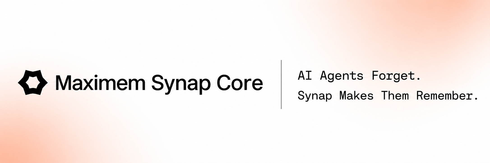
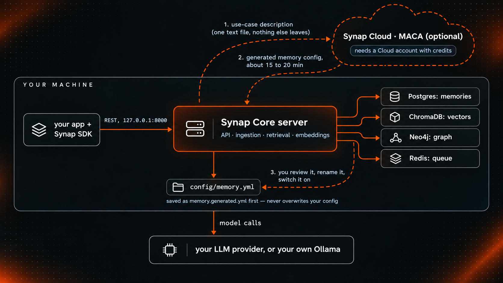

<p align="center">
  <picture>
    <source media="(prefers-color-scheme: dark)" srcset="assets/banner-dark.png">
    <source media="(prefers-color-scheme: light)" srcset="assets/banner-light.png">
    
  </picture>
</p>

<h3 align="center">Your agents forget between conversations. Synap Core is the open-source server that makes them remember.</h3>

<p align="center">
  Most memory layers store chunks of text and search them. Synap turns conversations into facts, preferences, events and episodes, works out who and what they are about, and replaces what is no longer true.
</p>

<p align="center">
  <a href="https://docs.maximem.ai/core/quickstart"><strong>Docs</strong></a> ·
  <a href="#quickstart"><strong>Quickstart</strong></a> ·
  <a href="https://github.com/maximem-ai/maximem_synap_sdk"><strong>SDKs & integrations</strong></a> ·
  <a href="https://github.com/maximem-ai/memory_and_context_eval_harness"><strong>Evals (reproduce our numbers)</strong></a> ·
  <a href="https://github.com/maximem-ai/maximem_synap_core/discussions"><strong>Discussions</strong></a> ·
  <a href="https://synap.maximem.ai"><strong>Synap Cloud</strong></a>
</p>

<p align="center">
  <a href="LICENSE"></a>
  <a href="https://github.com/maximem-ai/maximem_synap_core/pkgs/container/maximem_synap_core"></a>
  <a href="https://github.com/maximem-ai/memory_and_context_eval_harness"></a>
  <!-- add the stars badge after launch -->
  <!-- add a CI badge when a CI workflow exists -->
</p>

---

## The memory engine for production AI agents, self-hosted

Synap Core gives your agents memory that lasts across conversations, sessions and devices, and it runs on your own machine. It scores **83.6% on LongMemEval** ([results](benchmarks/RESULTS.md)); Synap Cloud, the managed service on the same architecture, scores **95.6%** ([every answer published](https://github.com/maximem-ai/eval_benchmark_runs_output)), both with the same answer model and judge. It is the full memory engine: it extracts memories from what users say, resolves who and what they are talking about, keeps track of time, and finds the right context when your agent asks. Your data stays on your disk. One `docker compose up` starts it.

It speaks the same API as [Synap Cloud](https://synap.maximem.ai), so the same [SDKs and framework integrations](https://github.com/maximem-ai/maximem_synap_sdk) work with both. Moving to Cloud later is a new base URL and an API key. Your application code does not change.

**No telemetry.** Synap Core calls out to your model provider, downloads its models once on first start, and, only if you opt in, to Synap Cloud and Jev. [Every outbound call is listed here.](#what-leaves-your-machine)

<p align="center">
  <a href="https://github.com/maximem-ai/maximem_synap_sdk/tree/main/packages/integrations/synap-langchain/"></a> &nbsp; <a href="https://github.com/maximem-ai/maximem_synap_sdk/tree/main/packages/integrations/synap-langgraph/"></a> &nbsp; <a href="https://github.com/maximem-ai/maximem_synap_sdk/tree/main/packages/integrations/synap-llamaindex/"></a> &nbsp; <a href="https://github.com/maximem-ai/maximem_synap_sdk/tree/main/packages/integrations/synap-crewai/"></a> &nbsp; <a href="https://github.com/maximem-ai/maximem_synap_sdk/tree/main/packages/integrations/synap-autogen/"></a><br />
  <a href="https://github.com/maximem-ai/maximem_synap_sdk/tree/main/packages/integrations/synap-haystack/"></a> &nbsp; <a href="https://github.com/maximem-ai/maximem_synap_sdk/tree/main/packages/integrations/synap-google-adk/"></a> &nbsp; <a href="https://github.com/maximem-ai/maximem_synap_sdk/tree/main/packages/integrations/synap-openai-agents/"></a> &nbsp; <a href="https://github.com/maximem-ai/maximem_synap_sdk/tree/main/packages/integrations/synap-semantic-kernel/"></a> &nbsp; <a href="https://github.com/maximem-ai/maximem_synap_sdk/tree/main/packages/integrations/synap-pydantic-ai/"></a><br />
  <a href="https://github.com/maximem-ai/maximem_synap_sdk/tree/main/packages/integrations/synap-agno/"></a> &nbsp; <a href="https://github.com/maximem-ai/maximem_synap_sdk/tree/main/packages/integrations/synap-livekit-agents/"></a> &nbsp; <a href="https://github.com/maximem-ai/maximem_synap_sdk/tree/main/packages/integrations/synap-pipecat/"></a> &nbsp; <a href="https://github.com/maximem-ai/maximem_synap_sdk/tree/main/packages/integrations/synap-claude-agent/"></a> &nbsp; <a href="https://github.com/maximem-ai/maximem_synap_sdk/tree/main/packages/integrations/synap-mastra/"></a><br />
  <a href="https://github.com/maximem-ai/maximem_synap_sdk/tree/main/packages/integrations/synap-vercel-adk/"></a> &nbsp; <a href="https://github.com/maximem-ai/maximem_synap_sdk/tree/main/packages/integrations/synap-eve/"></a> &nbsp; <a href="https://github.com/maximem-ai/maximem_synap_sdk/tree/main/packages/integrations/synap-nemo-agent-toolkit/"></a> &nbsp; <a href="https://github.com/maximem-ai/maximem_synap_sdk/tree/main/packages/integrations/synap-microsoft-agent/"></a><br />
  <a href="https://github.com/maximem-ai/maximem_synap_sdk/tree/main/packages/integrations/synap-strands-agents/"></a> &nbsp; <a href="https://github.com/maximem-ai/maximem_synap_sdk/tree/main/packages/integrations/synap-camel-ai/"></a> &nbsp; <a href="https://github.com/maximem-ai/maximem_synap_sdk/tree/main/packages/integrations/synap-smolagents/"></a> &nbsp; <a href="https://github.com/maximem-ai/maximem_synap_sdk/tree/main/packages/integrations/synap-deepagents/"></a>
</p>

<p align="center"><sub>Works with 23 frameworks. All of them, with install commands, are listed below.</sub></p>

---

## Quickstart

You need Docker with Compose (give Docker at least 6 GB of memory), a way to run a model (an API key for a provider, or your own [Ollama](https://docs.maximem.ai/core/local-models)), and about 8 GB of free disk for the server image and the models it downloads on first start.

**The first start takes minutes, not seconds.** It downloads about 2.3 GB of models, once. The download alone is about 3 minutes at 100 Mbit/s and about 12 minutes at 25 Mbit/s; with the image build or pull, allow 10 to 25 minutes to the first healthy server on the clone path. Once the models are on disk, later starts take a minute or two.

Pick one of three ways to get the server running, then [install the SDK](#install-the-sdk-and-point-it-at-your-server): [Option 1](#option-1-one-prompt-setup) pastes one prompt into your coding agent and is the fastest; [Option 2](#option-2-clone-the-repo) clones the repo and builds it, for reading or changing the code; [Option 3](#option-3-docker-image) pulls a prebuilt image, with no clone.

### Option 1: one-prompt setup

Paste this into Claude Code, Codex, Cursor or any coding agent, in an empty folder:

> Set up Synap Core on this machine. Install the Synap Core skill (`npx skills add maximem-ai/maximem_synap_core --skill synap-core -y`, or read https://github.com/maximem-ai/maximem_synap_core/tree/main/skills/synap-core) and follow it end to end. Ask me before anything that takes a long time or deletes data, and never ask me to paste an API key into this chat: I will put it in `.env` myself.

The [skill](skills/synap-core/) checks your machine, asks you a few questions (each with a recommendation), waits while you add your model key, starts the stack, and, while it starts, asks about your agent and writes a use-case file from your answers. It can also run the [MACA plugin](#design-your-memory-with-the-maca-plugin) for you. It ends with a real write-and-recall check. It never commits, never sees your key, and never deletes data without your yes. To install it yourself, or for agents that take one rules file, see [its README](skills/synap-core/README.md).

### Option 2: clone the repo

<details>
<summary><strong>Show the steps</strong></summary>

```bash
git clone https://github.com/maximem-ai/maximem_synap_core
cd maximem_synap_core
cp .env.example .env
chmod 600 .env
```

Open `.env` and set the two model lines, then the key line for your provider:

```text
SYNAP_LLM_PROVIDER=<openai | anthropic | ollama | openai-compatible>
SYNAP_LLM_MODEL=<the model name, exactly as your provider names it>
```

Synap Core does not pick a model for you. [Model setup →](https://docs.maximem.ai/core/local-models) Then start it:

```bash
docker compose -f deploy/docker-compose.yml up -d
```

The first start builds the image, generates the database passwords, downloads the embedding model once, and creates the schema. The server is ready when `docker compose -f deploy/docker-compose.yml ps` shows `synap` as healthy, at `http://127.0.0.1:8000`.

To stop it, run `docker compose -f deploy/docker-compose.yml stop`. `down` removes the containers and keeps your data; `down -v` removes the data too.

</details>

### Option 3: Docker image

No build and no clone. You need the Compose file, the example settings and the starter config.

<details>
<summary><strong>Show the steps</strong></summary>

```bash
mkdir synap-core && cd synap-core && mkdir deploy config
BASE=https://raw.githubusercontent.com/maximem-ai/maximem_synap_core/main
curl -fsSL -o deploy/docker-compose.yml $BASE/deploy/docker-compose.yml
curl -fsSL -o config/memory.yml $BASE/config/memory.yml
curl -fsSL -o .env.example $BASE/.env.example
cp .env.example .env && chmod 600 .env
```

Set the model lines and the key line in `.env`, as in Option 2. Then start it with the published image:

```bash
SYNAP_IMAGE=ghcr.io/maximem-ai/maximem_synap_core:latest SYNAP_PULL_POLICY=always \
  docker compose -f deploy/docker-compose.yml up -d
```

Use the same two variables on every `docker compose` command for this folder. `latest` follows the newest release; to stay on one, name the tag instead, for example `:0.1.0`. The image is built for `linux/amd64` and `linux/arm64`, and it runs as a non-root user.

To update, run `docker compose -f deploy/docker-compose.yml pull` and then `up -d` again, with the same two variables; your memories stay in their Docker volumes.

</details>

### Install the SDK and point it at your server

```bash
# Python 3.11+
pip install maximem-synap

# JavaScript / TypeScript, Node 20+
npm install @maximem/synap-js-sdk

export SYNAP_BASE_URL=http://127.0.0.1:8000
```

No API key and no instance id are needed for a local server. If your shell still has `SYNAP_API_KEY` from a Synap Cloud project, run `unset SYNAP_API_KEY` first: with a key set, the SDK acts as a Cloud client even when `SYNAP_BASE_URL` points here.

### Store a memory and read it back

```python
import asyncio
from maximem_synap import MaximemSynapSDK

async def main():
    sdk = MaximemSynapSDK()
    await sdk.initialize()
    try:
        result = await sdk.memories.create(
            document="User: I prefer dark mode.\nAssistant: Noted!",
            document_type="ai-chat-conversation",
            user_id="user_alice",
        )
        await sdk.memories.wait_for_completion(result.ingestion_id)

        context = await sdk.user.context.fetch(
            user_id="user_alice",
            search_query=["preferences"],
        )
        for p in context.preferences:
            print(p.content)
        # → "The user prefers dark mode."
    finally:
        await sdk.shutdown()

asyncio.run(main())
```

<details>
<summary><strong>JavaScript / TypeScript</strong></summary>

```javascript
import { SynapClient } from '@maximem/synap-js-sdk';

const sdk = new SynapClient();
await sdk.initialize();
try {
  const result = await sdk.memories.create({
    document: 'User: I prefer dark mode.\nAssistant: Noted!',
    document_type: 'ai-chat-conversation',
    user_id: 'user_alice',
  });
  await sdk.memories.wait_for_completion(result.ingestion_id);

  const context = await sdk.user.context.fetch({
    user_id: 'user_alice',
    search_query: ['preferences'],
  });
  for (const p of context.preferences ?? []) console.log(p.content);
} finally {
  await sdk.shutdown();
}
```

</details>

Synap rewrites what a user said into a short statement about them, so the printed sentence differs from the one you sent. The first memory can take up to a minute while the models load. If something does not start, the [quickstart](https://docs.maximem.ai/core/quickstart) lists what to check, and `docker compose -f deploy/docker-compose.yml down -v` starts you again from nothing.

---

## What you get

- **Memory extraction.** Conversations and documents become short, durable statements about people, preferences, facts and events. Compaction runs automatically in the background, so turns recorded one by one become long-term memory and long conversations keep a rolling summary.
- **Entity resolution.** When a user says *"my manager"* in turn 3 and *"Sarah"* in turn 12, Synap resolves them to one entity, across sessions and conversations, without the agent doing any work.
- **Temporal awareness.** Dates and times in what users say are understood and stored, and a newer fact that replaces an older one supersedes it instead of sitting next to it. Context from 30 minutes ago and from 30 days ago do not carry equal weight.
- **Vector and graph retrieval.** Two modes: **fast** searches vectors, **accurate** adds the knowledge graph. Compound questions ("X or Y", "X compared to Y") are split into parts automatically.
- **User and customer scoping.** Memory is kept apart per user and per customer, and install-wide facts are readable next to both. Choose the mode that fits your app before you store anything ([guide](https://docs.maximem.ai/core/scoping-mode)):

  ```
  strict            → business apps: a customer id and a user id on every request
  equals_customer   → consumer apps: every user is their own customer; send a user id only
  ```

- **Forget.** Delete a memory by id, or ask Synap to forget something by description ("ignore what I said about the budget"). Description-based forget needs your own Jev API key. [Forget →](https://docs.maximem.ai/core/forget)
- **Images.** Synap reads images in a conversation or an upload when the model you configured has vision. [Images →](https://docs.maximem.ai/core/images)
- **A memory config you write.** One YAML file decides what is remembered and how it is shaped. The server stops at start-up and names the line when the file has a mistake, so a setting is never silently ignored. [Configuration →](https://docs.maximem.ai/core/configuration)
- **A read-only memory browser.** Open `http://127.0.0.1:8000/browser` to see what was stored: memories, entities and your config.
- **Your models, your machine.** Use OpenAI, Anthropic, Ollama, or any server that speaks the OpenAI chat API. Embeddings run inside the server. [Local models →](https://docs.maximem.ai/core/local-models)

---

## Core vs Cloud

The open-source server is the full memory engine, self-hosted. Synap Cloud runs the same architecture, managed, with more on top. The SDK is the same for both: moving to Cloud is a base URL and an API key.

| | Open source | Synap Cloud |
|---|---|---|
| Memory extraction, entity resolution, temporal reasoning | Yes | Yes, tuned on production traffic |
| Vector + graph retrieval | Yes | Yes, plus recall-optimized indexing |
| Memory architecture | Write the YAML config yourself | Designed for you from a description of your use case (also available to self-hosters with the [MACA plugin](https://docs.maximem.ai/core/maca-plugin)) |
| Scoping | User and customer | Each fact placed at the right level automatically, custom levels, multi-agent memory sharing |
| Compaction | Automatic | Automatic |
| Deleting data | One memory, or by description with your own Jev key | Plus everything for a user, a conversation or a customer |
| Predictive prefetch | No | Yes |
| Low-latency retrieval mode | No | Yes |
| PII management | No | Yes |
| Dashboard, usage analytics, alerts | No | Yes |
| Authentication and multi-tenancy | Single tenant, no auth | Yes |
| LongMemEval | 83.6% ([results](benchmarks/RESULTS.md)) | 95.6% ([results](https://github.com/maximem-ai/eval_benchmark_runs_output)) |

When you call something that only exists on Cloud, the open-source server answers "not available in the open-source server", so you know it is not a bug in your code.

Reproduce any of these numbers with the [open eval harness](https://github.com/maximem-ai/memory_and_context_eval_harness). [Full comparison →](https://docs.maximem.ai/core/core-vs-cloud)

---

## Resolve, then supersede

Synap Core keeps a memory true by doing three things as one: it resolves who and what a memory is about, it records when that memory holds, and it replaces the memory when something newer says otherwise.

1. **An architecture you write.** `config/memory.yml` decides the memory types, extraction guidance, graph types, chunking, ranking weights, compaction and scoping, and the server stops at start-up on a mistake and names the line.
2. **Typed memories, not chunks.** Extraction sorts what it finds into facts, preferences, episodes, emotions and dated events, and each kind is stored and ranked as that kind.
3. **One entity, whatever it was called.** Before anything is stored, the entities in a document are resolved with our entity-resolution library, [`synap-er`](https://pypi.org/project/synap-er/), and a match it is unsure about is held for review instead of merged.
4. **Facts that know when they hold.** Each memory carries the period a state held and, for events, a dated window with its precision, so "last month" is stored as a date range.
5. **New replaces old.** Each new memory is compared with similar stored ones in the same scope and is either a duplicate (dropped), an enrichment (both kept), unrelated, or a supersession: the old one is retired and retrieval no longer returns it. This runs right after resolution, in the same stage of ingestion.

---

## How it runs

One server and four stores, started by one Compose file. Every store is a pinned upstream image pulled on first start, never built into ours, and none publishes a port.



Your data lives in Docker volumes and in the `originals/` folder next to `deploy/`, which keeps a copy of the text you stored. Upgrading Synap never touches stored memory.

### What leaves your machine

Four outbound calls, two of them optional:

1. Your LLM provider, or your own Ollama.
2. Hugging Face and GitHub, once, on first start: the two embedding models come from Hugging Face and the small English text model (spaCy) from GitHub, each at a fixed version and checked against a checksum. After that Synap Core makes no download.
3. Synap Cloud, only if you set a MACA plugin key.
4. Jev, only if you set a Jev key, for forget by description.

Synap Core sends no usage statistics, and the SDK sends none when pointed at a local server.

---

## Use it with your agent framework

Synap Core uses the same published SDKs and integration packages as Synap Cloud. Point them at your local server with `SYNAP_BASE_URL` and leave the API key out, and set `SYNAP_AUTO_LISTEN=false`: Core has no live gRPC stream, and without it the integrations log `synap: could not open the gRPC stream` once and retry about once a minute (turns still go over REST).

```bash
pip install maximem-synap maximem-synap-langchain
```

### All integrations

Every package is published as `maximem-synap-<framework>` on PyPI, or `@maximem/synap-<framework>` on npm. Each links to its source and README in the [SDK repository](https://github.com/maximem-ai/maximem_synap_sdk).

<details>
<summary><strong>Show all 25 packages</strong></summary>

| Framework | Package | Install |
|---|---|---|
| LangChain | [`maximem-synap-langchain`](https://github.com/maximem-ai/maximem_synap_sdk/tree/main/packages/integrations/synap-langchain/) | `pip install maximem-synap-langchain` |
| LangGraph | [`maximem-synap-langgraph`](https://github.com/maximem-ai/maximem_synap_sdk/tree/main/packages/integrations/synap-langgraph/) | `pip install maximem-synap-langgraph` |
| LlamaIndex | [`maximem-synap-llamaindex`](https://github.com/maximem-ai/maximem_synap_sdk/tree/main/packages/integrations/synap-llamaindex/) | `pip install maximem-synap-llamaindex` |
| CrewAI | [`maximem-synap-crewai`](https://github.com/maximem-ai/maximem_synap_sdk/tree/main/packages/integrations/synap-crewai/) | `pip install maximem-synap-crewai` |
| AutoGen | [`maximem-synap-autogen`](https://github.com/maximem-ai/maximem_synap_sdk/tree/main/packages/integrations/synap-autogen/) | `pip install maximem-synap-autogen` |
| Haystack | [`maximem-synap-haystack`](https://github.com/maximem-ai/maximem_synap_sdk/tree/main/packages/integrations/synap-haystack/) | `pip install maximem-synap-haystack` |
| Google ADK | [`maximem-synap-google-adk`](https://github.com/maximem-ai/maximem_synap_sdk/tree/main/packages/integrations/synap-google-adk/) | `pip install maximem-synap-google-adk` |
| OpenAI Agents SDK | [`maximem-synap-openai-agents`](https://github.com/maximem-ai/maximem_synap_sdk/tree/main/packages/integrations/synap-openai-agents/) | `pip install maximem-synap-openai-agents` |
| Semantic Kernel | [`maximem-synap-semantic-kernel`](https://github.com/maximem-ai/maximem_synap_sdk/tree/main/packages/integrations/synap-semantic-kernel/) | `pip install maximem-synap-semantic-kernel` |
| Pydantic AI | [`maximem-synap-pydantic-ai`](https://github.com/maximem-ai/maximem_synap_sdk/tree/main/packages/integrations/synap-pydantic-ai/) | `pip install maximem-synap-pydantic-ai` |
| Agno | [`maximem-synap-agno`](https://github.com/maximem-ai/maximem_synap_sdk/tree/main/packages/integrations/synap-agno/) | `pip install maximem-synap-agno` |
| LiveKit Agents | [`maximem-synap-livekit-agents`](https://github.com/maximem-ai/maximem_synap_sdk/tree/main/packages/integrations/synap-livekit-agents/) | `pip install maximem-synap-livekit-agents` |
| Pipecat | [`maximem-synap-pipecat`](https://github.com/maximem-ai/maximem_synap_sdk/tree/main/packages/integrations/synap-pipecat/) | `pip install maximem-synap-pipecat` |
| Claude Agent (Python) | [`maximem-synap-claude-agent`](https://github.com/maximem-ai/maximem_synap_sdk/tree/main/packages/integrations/synap-claude-agent/) | `pip install maximem-synap-claude-agent` |
| Claude Agent (TypeScript) | [`@maximem/synap-claude-agent`](https://github.com/maximem-ai/maximem_synap_sdk/tree/main/packages/integrations/synap-claude-agent-ts/) | `npm i @maximem/synap-claude-agent` |
| Mastra | [`@maximem/synap-mastra`](https://github.com/maximem-ai/maximem_synap_sdk/tree/main/packages/integrations/synap-mastra/) | `npm i @maximem/synap-mastra` |
| Vercel AI SDK | [`@maximem/synap-vercel-adk`](https://github.com/maximem-ai/maximem_synap_sdk/tree/main/packages/integrations/synap-vercel-adk/) | `npm i @maximem/synap-vercel-adk` |
| Vercel eve | [`@maximem/synap-eve`](https://github.com/maximem-ai/maximem_synap_sdk/tree/main/packages/integrations/synap-eve/) | `npm i @maximem/synap-eve` |
| NVIDIA NeMo Agent Toolkit | [`maximem-synap-nemo-agent-toolkit`](https://github.com/maximem-ai/maximem_synap_sdk/tree/main/packages/integrations/synap-nemo-agent-toolkit/) | `pip install maximem-synap-nemo-agent-toolkit` |
| Microsoft Agent Framework | [`maximem-synap-microsoft-agent`](https://github.com/maximem-ai/maximem_synap_sdk/tree/main/packages/integrations/synap-microsoft-agent/) | `pip install maximem-synap-microsoft-agent` |
| Strands Agents | [`maximem-synap-strands-agents`](https://github.com/maximem-ai/maximem_synap_sdk/tree/main/packages/integrations/synap-strands-agents/) | `pip install maximem-synap-strands-agents` |
| CAMEL-AI | [`maximem-synap-camel-ai`](https://github.com/maximem-ai/maximem_synap_sdk/tree/main/packages/integrations/synap-camel-ai/) | `pip install maximem-synap-camel-ai` |
| Smolagents | [`maximem-synap-smolagents`](https://github.com/maximem-ai/maximem_synap_sdk/tree/main/packages/integrations/synap-smolagents/) | `pip install maximem-synap-smolagents` |
| Deepagents | [`maximem-synap-deepagents`](https://github.com/maximem-ai/maximem_synap_sdk/tree/main/packages/integrations/synap-deepagents/) | `pip install maximem-synap-deepagents` |
| Remote MCP Server | [`maximem-synap-mcp-server`](https://github.com/maximem-ai/maximem_synap_sdk/tree/main/packages/mcps/synap-mcp-server/) | `pip install maximem-synap-mcp-server` |

</details>

---

## Design your memory with the MACA plugin

Writing the memory config by hand is fine. If you would rather describe your use case in a short file and get a config built for it, the MACA plugin sends that file from your Core server to Synap Cloud and saves the returned config next to your own, so you decide whether to use it. It needs a Synap Cloud account with credits. Only the description leaves your machine: no memories, conversations or user ids.

A run takes 15 to 20 minutes and creates an instance in your Cloud account. [Option 1](#option-1-one-prompt-setup) can do all of it for you while the stack starts.

[MACA plugin →](https://docs.maximem.ai/core/maca-plugin)

---

## Running it for real

Synap Core has no login. It is meant to sit behind your own backend and is never called from a client app. Anyone who can reach the port can read and write every memory, so the defaults are safe: the API listens on `127.0.0.1` only, database ports are not published, passwords are generated on first run, and an optional static token (`SYNAP_API_TOKEN`) protects it when you expose it on a network. The server prints a loud warning at start when no token is set.

[Running in production →](https://docs.maximem.ai/core/production) · [Security policy](SECURITY.md)

Real authentication and tenant isolation are part of [Synap Cloud](https://synap.maximem.ai).

---

## Benchmarks

Synap Core, run on all 500 questions of LongMemEval, scores **83.6%** (418 / 500). The retrieved memories, the answer and the judge's verdict for every question are in [`benchmarks/results/longmemeval/`](benchmarks/results/longmemeval/), so you can recompute the score.

| Benchmark | Synap Core | Scope | Answer model / judge |
|---|---|---|---|
| **LongMemEval**, all 500 questions ([results](benchmarks/RESULTS.md)) | **83.6%** (418 / 500) | Full set, 6 categories; one question that errored counted as wrong | `gemini-3.8-flash` / `gpt-4o` |
| **LongMemEval**, answerable questions | 83.0% (390 / 470) | 30 abstention questions excluded | `gemini-3.8-flash` / `gpt-4o` |

| Question type | Accuracy |
|---|---|
| single-session-user | 97.1% (68 / 70) |
| single-session-assistant | 92.9% (52 / 56) |
| knowledge-update | 91.0% (71 / 78) |
| single-session-preference | 90.0% (27 / 30) |
| temporal-reasoning | 78.2% (104 / 133) |
| multi-session | 72.2% (96 / 133) |

The run is from 2 Nov 2026, on a server started with the Compose file in this repo and the sample config as shipped, with `gemini-3.1-pro-preview` doing the extraction. The judge is LongMemEval's own question-type-specific prompt set at a pinned upstream commit. [Methodology](benchmarks/METHODOLOGY.md) · [How to re-run](benchmarks/README.md)

For comparison, Synap Cloud scores **95.6% on LongMemEval**, with every LongMemEval answer [published](https://github.com/maximem-ai/eval_benchmark_runs_output) and the harness [open](https://github.com/maximem-ai/memory_and_context_eval_harness). Scores depend on the answer model, the judge and the extraction model, so compare numbers only when those match.

---

## Docs

The Synap Core section of [docs.maximem.ai](https://docs.maximem.ai/core/quickstart): [Quickstart](https://docs.maximem.ai/core/quickstart) · [Configuration](https://docs.maximem.ai/core/configuration) · [Local models (Ollama)](https://docs.maximem.ai/core/local-models) · [Choosing the scoping mode](https://docs.maximem.ai/core/scoping-mode) · [Forget](https://docs.maximem.ai/core/forget) · [Images](https://docs.maximem.ai/core/images) · [MACA plugin](https://docs.maximem.ai/core/maca-plugin) · [Running in production](https://docs.maximem.ai/core/production) · [Cost notes](https://docs.maximem.ai/core/cost-notes) · [Core vs Cloud](https://docs.maximem.ai/core/core-vs-cloud)

## Deep dives

- 📘 **[Why we built Synap](https://www.maximem.ai/blog/why-we-built-synap)**: the problem with current AI memory systems
- ⚙️ **[How Synap works under the hood](https://www.maximem.ai/blog/how-maximem-synap-works)**: architecture, retrieval pipeline, and design decisions
- 📊 **[Benchmark results](https://www.maximem.ai/blog/synap-benchmark-results)**: methodology and reproducibility
- 🧪 **[Evaluation harness](https://github.com/maximem-ai/memory_and_context_eval_harness)**: run the benchmarks yourself against Synap, Mem0, Zep and Supermemory

---

## Resources & community

- 📖 [Documentation](https://docs.maximem.ai/core/quickstart)
- 🧰 [SDKs & framework integrations](https://github.com/maximem-ai/maximem_synap_sdk)
- 🧪 [Evaluation harness](https://github.com/maximem-ai/memory_and_context_eval_harness) and [benchmark run data](https://github.com/maximem-ai/eval_benchmark_runs_output)
- ☁️ [Synap Cloud dashboard](https://synap.maximem.ai)
- 💬 [GitHub Discussions](https://github.com/maximem-ai/maximem_synap_core/discussions): questions, ideas, show what you built
- 🐛 [Issues](https://github.com/maximem-ai/maximem_synap_core/issues): bugs and gaps
- 🔒 [Security policy](SECURITY.md)
- 𝕏 [Twitter / X](https://x.com/maximem_ai)
- 💼 [LinkedIn](https://www.linkedin.com/company/maximem-ai)

---

## Contributing

Bug reports, questions and ideas are very welcome as [issues](https://github.com/maximem-ai/maximem_synap_core/issues) and in [Discussions](https://github.com/maximem-ai/maximem_synap_core/discussions). Pull requests are welcome for the setup around the engine (`deploy/`, `config/`, `e2e/`, `skills/`, the docs). The engine under `synap/` is copied here from our source repository on every sync, so a pull request against it would be overwritten and gets closed: open an issue instead. Every commit needs a DCO sign-off (`git commit -s`). See [CONTRIBUTING.md](CONTRIBUTING.md).

---

## Maintainers

- [Gaurav Dadhich](https://github.com/dadhichgaurav1)
- [Shreyansh Singh Gautam](https://github.com/Shreyanshsingh23)
- [Anish Yadav](https://github.com/visy-ani)

---

## License

Apache 2.0 (see [LICENSE](LICENSE) and [NOTICE](NOTICE)). The SDKs and integration packages are in their own [repository](https://github.com/maximem-ai/maximem_synap_sdk) and declare their own licenses.

---

<p align="center">
  Built by <a href="https://www.maximem.ai"><strong>Maximem AI</strong></a>
</p>
